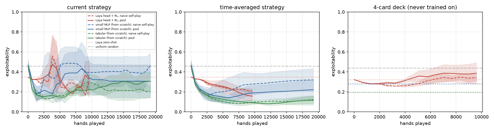
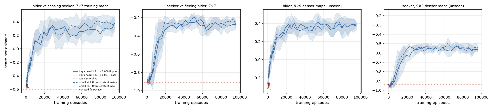
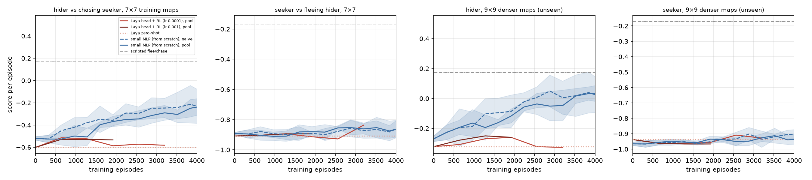

# Can a small decision model be the policy?
### Training Laya's decision head with self-play PPO in text poker and text hide-and-seek

*abhijithneilabraham · October 2026 · code and raw results: `experiments/laya_policy/`*

---

## Abstract

OpenAI's hide-and-seek agents learned from scratch: a small network, PPO, and self-play against past
versions of themselves, over hundreds of millions of episodes. Small open decision models such as
Laya (421M parameters: a frozen 395M ModernBERT encoder and a 26.5M decision head) already answer
multiple-choice questions about a situation written in English, with calibrated probabilities. We ask
whether such a model can *be* the policy: every decision becomes a Laya `choice` question, the legal
moves are the options, and PPO with an opponent pool trains only the decision head. We test this on
two games with exact or scripted evaluation, against a lookup table and a from-scratch MLP, at equal
numbers of games, on one 8 GB laptop.

The answer is mostly **no**. In 3-card Kuhn poker, Laya starts better than random (exploitability
0.348 vs 0.458) and RL improves it (time-averaged 0.155 ± 0.044 with an opponent pool after 9,600
hands), slightly ahead of the MLP (0.189 ± 0.075, within one s.d.) but clearly behind a lookup table
(0.092 ± 0.013). The hoped-for language advantage did not appear. On a 4-card deck described in words
but never played, RL-trained Laya was worse than its card-blind untrained self (0.387 vs 0.323) and
sometimes folded the Ace, "the highest card", to a bet; a hand-written rank mapping of the lookup
table did better (0.196). In grid hide-and-seek the MLP hider outscores a hand-written fleeing
strategy within ~12k episodes, on training maps and on larger unseen maps. Laya's head barely moves in
3,200 episodes at two learning rates (hider −0.60 → −0.58, against −0.25 for the MLP at the same
budget): its zero-shot policy is near-uniform, and RL shifts a global bias instead of learning to read
the situation. Each Laya update costs ~1,000× the MLP's compute. In poker the opponent pool helped both
learned policies, reproducing the hide-and-seek lesson at small scale; on the grid it made no
difference for the MLP. We report this as a careful negative result and say what would have to
change for the idea to work.

---

## 1. Question

Hide-and-seek (Baker et al., 2019) showed that a simple recipe — PPO, self-play, a policy that reads
entities with attention — yields rich behaviour if one can afford enough episodes. Language-model
policies (e.g. GLAM, Carta et al. 2023; TWOSOME, Tan et al. 2024) showed the other route: start from a
model that already understands the situation and fine-tune it with RL, trading episodes for
parameters. Those works use multi-billion-parameter generative LMs.

Laya sits between the two. It is small enough to run on a laptop CPU, it is built for exactly the
operation a policy needs (pick one of N options given a described situation, with probabilities),
and its decision head is only 26.5M parameters, so RL can train it without touching the encoder.
We found no prior work that trains an encoder decision model of this kind as an RL policy.

**Hypotheses.**
- **H1 (sample efficiency).** Because Laya understands the situation text, its policy needs fewer
  games than a from-scratch network to reach the same strength.
- **H2 (language transfer).** Because the state is English, a policy trained on one variant should
  carry over to a variant described in the same words (a bigger deck, a bigger map) without retraining.
- **H3 (hide-and-seek recipe).** Self-play against a pool of past selves is more stable than naive
  self-play, for Laya as for the small network.

## 2. Method

**Laya as a policy.** For each decision we build a Laya `choice` question:

> *State:* "Poker, one betting round. The deck has 3 cards, ranked low to high: Jack, Queen, King.
> Each player paid 1 chip and got one card. You hold the Queen, the middle card. You act first. You
> checked, then your opponent bet 1 chip."
> *Question:* "Choose your poker action. Win as many chips as possible over many hands."
> *Options:* "fold: give up the pot" / "call: match the 1 chip bet"

> *State:* "Hide-and-seek on a grid with walls. You are the hider. The seeker is far away, to the
> north-west. You cannot see each other. Blocked: west. Open: north, south, east. The seeker is still
> counting and cannot move yet. Sight works only along a straight row or column with no wall in between."
> *Options:* north / south / east / west / stay.

The policy π(a | s) is Laya's option distribution at its shipped choice temperature (1.25). The
encoder is frozen; its token states are cached once per distinct situation text (fp16, LRU), so each
decision costs one pass through the 2-layer head. The head (26.5M parameters, including the type
embedding and scorer) is trained with Adam. Our reimplementation of the forward pass matches Laya's
own probabilities to within 0.006.

**RL.** PPO with clip 0.2, entropy bonus 0.01, two epochs per batch, gradient clipping at 1.0,
advantages from a running per-observation value table (discount 0.97 on the grid), normalised per
batch. Every agent in the game is the same network (self-play). **Pool** runs follow the
hide-and-seek / AlphaStar league idea: every 10 updates a snapshot is saved, and 75% of batches are
played against a random one of the last 4 snapshots. **Naive** runs always play the current self.

**Baselines** see the same games through the same PPO loop:
- *Tabular*: one logit vector per information set (Kuhn only; 12 information sets).
- *MLP*: 64-64 tanh network per role on a numeric encoding with the same information as the text
  (Kuhn: 7 features; grid: 19 features). This is the hide-and-seek-era recipe at laptop scale.
- *Laya zero-shot*: the untrained Laya policy.

**Fair comparison.** All learning curves are plotted against games played, and tables report every
method at Laya's budget (9,600 poker hands; 3,200 grid episodes). Baselines also ran longer to show
where they end up.

## 3. Environments

**Kuhn poker** (3 cards, one bet). Small enough for exact evaluation: we compute the
**exploitability** of the policy (average best-response gain over both seats; 0 at Nash, 0.458 for
uniform random). Because self-play policies oscillate, we report both the current strategy and the
time-averaged strategy (the quantity that converges in fictitious play).
*Transfer test:* a 4-card deck (Jack–Ace) described in the same words. Text policies are evaluated
directly; the tabular and MLP policies, which cannot read a new card, get a hand-written mapping
(lowest → Jack, highest → King, middle cards → Queen) — the best a non-language policy can do without
retraining. Uniform random scores 0.4375 on 4 cards.

**Grid hide-and-seek.** 7×7 random walled maps (18% walls), 16 turns, 3 prep turns in which the
seeker cannot move. Each turn after prep the hider gets +1/13 while unseen and −1/13 while seen;
sight runs along a clear row or column. Observations are egocentric and coarse (direction in 8
sectors, distance in 3 bands, sight, blocked sides, phase), so the same text describes any map.
*Evaluation* is against scripted opponents: a hider against a BFS-chasing seeker, a seeker against a
line-of-sight-breaking fleeing hider, on the training distribution and on unseen 9×9 maps with 25%
walls. For reference, the scripted fleeing hider scores +0.17 against the chaser; standing still
scores −0.61. Training batches are half self-play, half against the scripted opponents (without the
scripted half the MLP learned too slowly to be a useful reference; see §5.3).

## 4. Results

### 4.1 Kuhn poker

Exploitability, lower is better. Mean ± s.d. over seeds. Laya runs are 150 updates × 64 hands.

| Policy | Opponents | Seeds | Start | Current, at 9,600 hands | **Time-avg, at 9,600 hands** | Time-avg, at 19,200 | Best seen | 4-card deck (time-avg) |
|---|---|---|---|---|---|---|---|---|
| Laya + PPO | pool | 3 | 0.348 | 0.328 ± 0.183 | **0.155 ± 0.044** | — | 0.141 | 0.387 |
| Laya + PPO | naive | 2 | 0.348 | 0.311 ± 0.129 | 0.208 ± 0.025 | — | 0.163 | 0.341 |
| Laya zero-shot | — | 1 | 0.348 | 0.348 | 0.348 | — | — | 0.323 |
| MLP | pool | 5 | 0.467 | 0.339 ± 0.158 | 0.189 ± 0.075 | 0.222 | 0.149 | 0.281 (hand-mapped) |
| MLP | naive | 5 | 0.467 | 0.394 ± 0.158 | 0.277 ± 0.110 | 0.320 | 0.133 | 0.404 (hand-mapped) |
| Tabular | pool | 5 | 0.458 | 0.225 ± 0.059 | **0.092 ± 0.013** | 0.120 | 0.104 | **0.196** (hand-mapped) |
| Tabular | naive | 5 | 0.458 | 0.298 ± 0.079 | 0.097 ± 0.022 | 0.113 | 0.101 | 0.149 (hand-mapped) |

**H1, partly.** Laya starts ahead of random (0.348 vs ~0.46), but not because it reads the hand:
zero-shot, its play is almost identical for every card (bet ≈ 0.53, call a bet ≈ 0.66 for Jack, Queen
and King alike). The head start comes from calling more often than uniform, not from poker sense.
PPO then teaches it to use the card (fold the Jack, call with the King). But the tabular learner overtakes it
within ~1,000 hands and ends 40% less exploitable. Laya beats the MLP at equal budget, though
the gap (0.155 vs 0.189) is within one standard deviation. In a game with 12 information sets
nothing beats a table; the useful comparison is the MLP, and there the advantage is small.

**H2, rejected.** On the unseen 4-card deck, trained Laya (0.387 pool, 0.341 naive) is *worse* than
the card-blind untrained policy (0.323), and the hand-mapped table (0.196) beats every Laya policy.
The per-card behaviour shows why. The state text says "You hold the Ace, the highest card", yet when
facing a bet, trained Laya calls with the Ace in only 3 of 5 runs and folds it in the other 2 (call
probability 0.02 and 0.00). It learned what to do with the words *Jack*, *Queen*, *King*, not with
*the highest card*. The language interface did not give transfer for free.

**H3, supported.** The pool lowered time-averaged exploitability for Laya (0.208 → 0.155) and for the
MLP (0.277 → 0.189), and reduced the naive runs' large swings (one naive Laya run jumped to 0.75
mid-training). For the table, which converges anyway, it made no difference.

**A failure mode worth noting.** Laya's head saturates fast: within ~50 updates most information
sets are played with probability > 0.99 (see final strategies in the result files). Self-play then
cycles between pure strategies, which is why current-strategy exploitability is noisy and
time-averaging matters so much. Lower learning rates (3e-5) barely moved the policy; higher ones
(3e-4, 1e-3) oscillated more (§5.3).

### 4.2 Grid hide-and-seek

Score per episode against the scripted opponents (−1 to +1, higher is better); mean ± s.d. over
seeds. Laya runs are 32 episodes per update.

| Policy | Seeds | Episodes | Hider vs chaser, 7×7 | Seeker vs fleer, 7×7 | Hider, 9×9 unseen | Seeker, 9×9 unseen |
|---|---|---|---|---|---|---|
| Laya zero-shot | 1 | 0 | −0.60 | −0.91 | −0.32 | −0.94 |
| Laya + PPO, pool, lr 1e-4 | 1 | 3,200 | −0.58 | −0.84 | −0.33 | −0.93 |
| Laya + PPO, pool, lr 1e-3 | 1 | 1,920 † | −0.53 | −0.89 | −0.26 | −0.97 |
| MLP, pool — at 3,200 | 5 | 3,200 | **−0.29 ± 0.07** | −0.86 ± 0.03 | **−0.05 ± 0.10** | −0.93 ± 0.02 |
| MLP, naive — at 3,200 | 5 | 3,200 | **−0.25 ± 0.09** | −0.87 ± 0.05 | **+0.01 ± 0.11** | −0.94 ± 0.05 |
| MLP, pool — final | 5 | 96,000 | +0.39 ± 0.11 | −0.28 ± 0.05 | +0.38 ± 0.02 | −0.56 ± 0.03 |
| MLP, naive — final | 5 | 96,000 | +0.37 ± 0.06 | −0.27 ± 0.05 | +0.37 ± 0.04 | −0.54 ± 0.03 |
| *Scripted flee / chase* | — | — | +0.17 | −0.17 | — | — |

† planned for 100 updates; stopped at 60 because it was flat and the laptop had slept mid-run.

**H1, rejected on the grid.** At equal episodes the MLP hider improves by ~0.25 while Laya's moves by
0.02–0.07, within evaluation noise. Neither learns the seeker role in 3,200 episodes, so that column
does not separate them. Given enough episodes, the MLP hider outscores the scripted fleeing strategy on both the
training maps and the larger unseen maps, so the coarse egocentric observation transfers across map
sizes even without language. Laya had no transfer to show because it learned nothing to transfer.

**Why Laya does not learn here (diagnostic).** We tracked Laya's action distribution on 40 fixed probe
situations per role over 6 PPO updates at lr 1e-3. Zero-shot, the policy is almost uniform (entropy
1.57 nats; the maximum is 1.61): Laya has no opinion about which way to move. Training moves the
head's weights a lot (parameter change, L2 norm 12.6), yet the policy changes mainly through a
*global* bias. Both roles drift toward "north" (hider 0.18 → 0.27, seeker 0.19 → 0.30) whatever the
situation says, and entropy falls only to 1.53 / 1.45. The head finds it easier to shift all answers
than to read directions and walls out of the frozen encoding. In poker, by contrast, there are 28
situations separated by one salient word (the card), and the head learned to use it.

### 4.3 Compute

On one M1 laptop CPU (4 threads):

| | Kuhn, s / update (64 hands) | Grid, s / update (32 episodes) | Peak memory |
|---|---|---|---|
| Tabular | 0.004 | — | < 0.2 GB |
| MLP | 0.005 | 0.04 | < 0.3 GB |
| Laya head | 4.8 | 51 | 3.6 GB |

The frozen-encoder cache makes Laya feasible (≈1,250 distinct grid situations, 28 poker situations
are each encoded once), but every decision still passes through a 26.5M-parameter head over ~80
tokens of state, three orders of magnitude more than the MLP. At equal *wall-clock*, the MLP sees
~1,000× more games, which makes H1 moot in practice unless Laya wins at equal games by a wide margin.

## 5. Discussion

### 5.1 Why didn't the language prior help more?

1. **The prior is weak where it matters.** Laya was trained to judge described situations, not to
   play games. Zero-shot it ignores the card in poker and plays hide-and-seek about as well as
   standing still, so there is little prior to exploit. Hide-and-seek strategy
   (break line of sight, use walls) is not in the text and must be learned, which is exactly what a
   small net does cheaply.
2. **RL learns surface tokens, not concepts.** We train the whole head on 28 distinct poker texts.
   The cheapest way to separate them is the card's name, and that is what it learned: the Ace, which
   the text calls the highest card, is sometimes folded. A KL penalty to the zero-shot policy, or training only a small adapter,
   would preserve more of it; we did not test these.
3. **The observations are already abstract.** We gave the MLP the same coarse information as the
   text. When the hand-made features are this good, language adds nothing; its value would show up
   only when the state is too rich or too varied to hand-encode.
4. **Saturation.** The head produces near-deterministic choices after a few updates, so exploration
   collapses. Laya's calibration is tuned for answering questions, not for keeping a policy stochastic.

### 5.2 Is this new, and does it matter?

New, narrowly: we found no prior report of an encoder decision model (as opposed to a generative LLM)
trained as an RL policy, nor of opponent-pool self-play with one. But the result is negative on the
two hypotheses that would make the idea useful (sample efficiency and transfer), and positive only on
the one that was already known (opponent pools stabilise self-play). An honest placement:

- **Not** a main-track conference contribution: the games are small, seeds are few (2–3 for Laya,
  limited by 1–1.5 h per run on a laptop), and the main claim is "this doesn't work as set up".
- **Plausible** as a short workshop paper or blog post on negative results / small-model RL, if
  extended with the two cheapest fixes below so the negative result is not just a tuning artefact.
- **Useful** practically as a warning: wrapping a decision model as a policy costs ~1,000× compute,
  and fine-tuning it with RL erodes the zero-shot generality that was the reason to use it.

### 5.3 Robustness checks and limitations

- **Learning rate.** Kuhn: 30-update sweep at 1e-4 (chosen; 0.348 → 0.278), 3e-4 (unstable, ended
  0.56), 1e-3 (noisy, 0.33). Grid: 1e-4 and 1e-3 both flat (§4.2); a 10× learning rate changed the weights far more but not the outcome.
- **Grid training setup.** A first grid design (pure self-play, 4,800 episodes) left the MLP near
  its starting point (hider −0.52 → −0.46/−0.50). We changed it before running Laya: half the
  batches against the scripted opponents and 96,000 episodes for the MLP. All grid numbers above
  use the second design; the first is kept in the result tables for transparency.
- **Seeds.** 5 per baseline, 2–3 per Laya poker setting, 1 per Laya grid setting (each grid run took
  1.5 h; with both learning rates flat, more seeds would not change the conclusion). Differences under
  one standard deviation should not be read as real.
- **Untested fixes.** KL-to-prior regularisation; training a LoRA/adapter instead of the full head;
  richer observations where hand-made features are hard (e.g. raw map text); more value-function
  machinery (a learned critic instead of a per-observation table).

## 6. What would make this worth pursuing

The idea is only interesting where language beats hand-made features. A sharper next test would:
1. use states that are *naturally* text and varied (rules written differently each episode, new
   card types defined in words, maps described freely), where an MLP cannot be given a fixed
   feature vector;
2. keep Laya's zero-shot ability by regularising to it (KL) and training a small adapter;
3. measure transfer to new rules, not only new sizes.

Without those changes, a small from-scratch network with an opponent pool — the hide-and-seek recipe —
remains the better choice on a laptop.

## References

- Baker, B., et al. (2019). Emergent Tool Use From Multi-Agent Autocurricula. arXiv:1909.07528.
- Carta, T., et al. (2023). Grounding Large Language Models in Interactive Environments with Online
  Reinforcement Learning (GLAM). ICML.
- Heinrich, J., & Silver, D. (2016). Deep Reinforcement Learning from Self-Play in Imperfect-Information
  Games (NFSP). arXiv:1603.01121.
- Kuhn, H. W. (1950). A Simplified Two-Person Poker. Contributions to the Theory of Games.
- Lanctot, M., et al. (2017). A Unified Game-Theoretic Approach to Multiagent Reinforcement Learning (PSRO). NeurIPS.
- Schulman, J., et al. (2017). Proximal Policy Optimization Algorithms. arXiv:1707.06347.
- Tan, W., et al. (2024). True Knowledge Comes from Practice: Aligning LLMs with Embodied
  Environments via Reinforcement Learning (TWOSOME). ICLR.
- Vinyals, O., et al. (2019). Grandmaster level in StarCraft II using multi-agent reinforcement learning. Nature.
- Convai Innovations. Laya decision model, `convaiinnovations/laya` (Hugging Face), v0.4.2.
