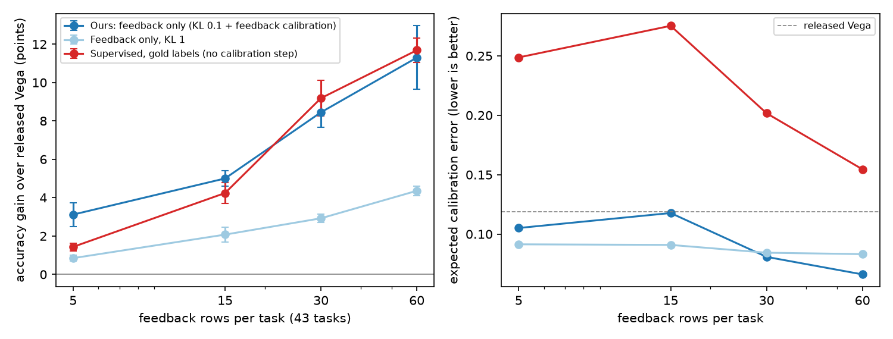

# Learning from right and wrong
### How the Vega decision model can learn from user feedback, without labels, and keep honest probabilities

*abhijithneilabraham · October 2026 · code and raw results: `experiments/vega_policy/`*

---

## Summary

**The model.** Vega is a small decision model. It has two parts:
- A frozen backbone: Qwen, with 0.8 billion parameters.
- An "engine" with 14.3 million parameters. The engine makes the decision.

Vega gives a probability for each answer. Its probabilities are calibrated [when the model says
"70% sure", it is correct about 70% of the time]. Vega runs on your own computer. Thus, no data goes to
an outside company, and each decision takes some milliseconds.

**The problem.** After a company starts to use a model, it almost never gets gold labels. But it often gets feedback on the answer that the model
gave. Examples:
- A user accepts a suggestion.
- A user cancels an action.
- A user clicks "thumbs down".

We ask this question: can Vega improve from this right-or-wrong signal only?

[In machine learning, this setting is a "contextual bandit". The model sees a situation (the context),
selects one action, and gets a reward for that action only. It never learns what the best action was.]

**Our method has two parts:**
1. **Learning.** We add a small new part (an "adapter") to the engine. We train the adapter with
   REINFORCE [a basic reinforcement-learning (RL) rule: make rewarded answers more probable, and make
   unrewarded answers less probable]. A "KL anchor" stops the model from moving too far from the
   original model. [KL divergence measures how different two probability distributions are.]
2. **Calibration from feedback.** RL makes the model too confident. We correct this with one number,
   the "temperature", and we find this number from the same right-or-wrong signal. The method uses one fact about calibrated models. When such a model selects an answer, the answer is right as often as its probability says.

**The test.** We use exactly the 1,075 DecisionBench rows that Vega's own README uses. We learn from 3,205 different rows of the same 43 tasks. Our method never sees a
label. It sees only a reward of 1 (right) or 0 (wrong). We ran each training method 3 times with
different random seeds.

**Results:**
- Accuracy increases from **0.509 to 0.611**. This is +10.2 points. The 95% confidence interval (CI)
  is [+7.9, +12.6].
- NLL decreases from 1.628 to **1.291**. [NLL, "negative log-likelihood", measures how much probability
  the model gave to the correct answer. Lower is better.]
- ECE decreases from 0.098 to **0.054**. [ECE, "expected calibration error", measures the difference
  between the confidence and the real accuracy. Lower is better.] This is the best ECE of all the
  methods that we tested.
- Vega's own adaptation tool, `fit()`, gets 0.531. It uses the *gold labels* of all 3,205 rows. Our
  method uses no labels, and it is **+8.0 points [+5.6, +10.5]** better.
- A standard supervised method gets 0.627. It
  reads every label. Our method is not significantly different from it: −1.6 points [−3.5, +0.3]. Also,
  our method is better calibrated.

**Three control tests show where the gain comes from:**
- If we remove the calibration step, ECE is 0.24 to 0.29 (much worse).
- If we remove Vega's engine and keep everything else, accuracy is 0.26 (much worse).
- If we make the KL anchor 10 times stronger, the gain decreases to +3.8 points.

**More results:**
- On a larger test set (1,720 rows), the gain increases with more feedback. It is +3.1 points with 5 rows for each task, and +11.3 points with 60 rows.
- With one pass [the model sees each row one time only, as in real use], the gain is +6.9 points.
- Feedback from 33 tasks also improves 10 tasks that the model did not see: +4.2 points.
- The adapter adds 409 thousand parameters and approximately 0.2 ms to each decision.
- We also report a smaller result in a poker game, and some ideas that did not work.

---

## 1. Why this is important

Companies put decision models in AI agents, moderation systems and customer-support systems. Such a
model makes thousands of small decisions each day. Examples:
- Is this tool call dangerous?
- Must a person examine this request?
- Which category is correct for this message?

It is expensive to label these decisions.
Thus, most teams do not do it. But feedback on the decisions is almost free:
- The user cancels the action.
- The reviewer changes the decision.
- The customer writes "That is not what I asked".

A model that improves from this feedback is useful to all users of such models. The model must not
become overconfident while it learns. This is very important for a model that runs locally, because then no data goes out of the computer.

Calibration is the difficult part. Calibration is the main advantage of Vega in its README. On
DecisionBench, Vega is 24 accuracy points below a hosted model. But Vega's likelihood is two times better.

Fine-tuning usually damages calibration. We saw this too: our supervised adapters had an ECE of 0.15 to 0.33 before correction. The
standard correction is "temperature scaling", but it needs labelled data. Thus, we needed a method
that does two things with feedback only:
- It increases accuracy.
- It keeps the calibration.

## 2. Setup

### 2.1 Vega

We use `vegaml` version 0.8.0 with the public model `nandakishorm/vega-08b-public-intents`. It has
these parts:
- **A frozen backbone.** Qwen3.5-0.8B reads the text. Vega uses the outputs of layers 13 and 19
. Vega
  "pools" these outputs.
- **The engine, 14.3 million parameters.** The engine uses a physics model. Each answer is a "potential
  well" [a low point in a landscape, like a hole]. A particle moves through the landscape, and the
  answer is the well where the particle stops. A deeper well means a lower "energy" and a more probable
  answer.
- **A thermal calibration.** It sets a temperature for each question from the path of the particle.
  [Temperature controls how sure the probabilities are. A high temperature makes the probabilities
  more equal. A low temperature makes the top answer more dominant.]
- **Two adapters, which Vega selects automatically.**

We do not change any of these parts. They stay exactly as Vega releases them.

### 2.2 The benchmark and the exact test set

DecisionBench (`Hanno-Labs/decision-bench`) has 43 tasks. The tasks use three question types
("primitives") in 28 domains. Some domains are agent control, privacy, legal, robotics and tax
documents.

Vega's README uses a "slice" of 1,075 rows. A notebook in the Vega
project makes this slice: 25 rows for each task, with the random seed 20261011. We copied the sampling
code exactly. It gives exactly the same 1,075 rows.

We also did a check of our pipeline:
- We saved the backbone outputs ("cached features") one time, so that we do not run the large backbone
  again.
- We ran the engine on these saved features.
- The probabilities are exactly equal to the official `Vega.decide()` probabilities. The difference is
  0.0 on each row that we examined.
- We get the same numbers as the README: accuracy 0.509, NLL 1.628, and KL to gold 1.012.

**These 1,075 README rows are our test set.**

### 2.3 The data for learning (the "pool")

We ran the same sampling code with 100 rows for each task. This gives 4,280 rows. These rows include
all of the 1,075 test rows. The other 3,205 rows are the pool.

From each task in the pool, we kept 20% (641 rows in total) for calibration only. Thus, 2,564 rows stay
for learning. All methods get the same rows.

### 2.4 The feedback

For each pool row, the model selects an answer at random from its own probabilities. Then it gets a reward:
- r = 1 if the answer is the correct (gold) answer.
- r = 0 if the answer is not correct.

The model gets no other information about the label. This feedback is simulated [we make it from the
gold labels]. Real feedback has more errors. Section 8 discusses this limitation.

## 3. Method

### 3.1 The policy

Our policy is Vega's own calibrated output:

  π(a|s) = softmax(−E_a / τ(s))

[Read this as: "the probability of answer a in situation s". E_a is the energy of answer a, from the
engine. τ(s) is the temperature for this situation. Softmax changes a list of numbers into
probabilities that add up to 1. A lower energy gives a higher probability.]

The engine with the new adapter gives the energies. We keep the shipped temperature τ(s) fixed.

### 3.2 What we train

We attach one gated LoRA adapter, with rank 8, to the input layers of the engine. We use vegaml's own
function `attach_adapter`.
- [LoRA, "low-rank adaptation", adds two small matrices to a layer. Their product is a small change to
  the layer. "Rank 8" sets the size of the matrices. A small rank gives few parameters.]
- ["Gated" means that a small network, the gate, decides how much of the adapter to use for each
  question.]

The adapter has 409 thousand parameters. This is 2.9% of the size of the engine. Its gate starts open.
The two shipped adapters continue to work exactly as before.

### 3.3 The update rule

The loss for each batch is:

  L = −(r − b) · log π(a|s) + β · KL(π(·|s) ‖ π₀(·|s)),   β = 0.1

- **First term (REINFORCE).** r is the reward. b is the average reward recently (the "baseline"). If an
  answer gets more reward than the average, its probability increases. If it gets less, its probability
  decreases. [The baseline makes learning more stable. It shows which answers are better than normal,
  not only which answers are good.]
- **Second term (the KL anchor).** π₀ is the original model. The term increases when the new model
  moves away from the original model. β = 0.1 sets the strength of the anchor.

Training settings: 8 passes through the pool, batches of 32 rows, and the Adam optimizer with a learning
rate of 0.001.

Why the anchor is necessary: without it, the model "collapses" [it puts almost all probability on a few
answers, also on answers that are wrong]. Without the anchor, NLL increases to 7.5. We saw the same
collapse first in the poker experiment (Section 7).

### 3.4 Calibration from feedback

RL makes the probabilities too sharp. After training, the uncorrected model has an ECE
of 0.24 to 0.29.

The correction uses one fact. Assume that a model is calibrated. Then the answer that it selects is
correct with probability p(a) exactly. Thus, each logged pair (answer a, reward r) is a "Bernoulli"
observation of p(a). [A Bernoulli observation is one yes-or-no result, like one toss of a coin with
probability p.]

The procedure:
1. Use the 641 rows that you kept for calibration.
2. For each row, let the model select an answer a.
3. Record the reward r (1 or 0).
4. Find the temperature T that gives the highest value of this sum:

  Σ r · log p_T(a) + (1 − r) · log(1 − p_T(a))

[p_T(a) is the probability of answer a after we divide the scores by T. The sum is the "log-likelihood"
of the rewards. A high value means that the probabilities agree with how often the model is really
right.]

T is one number. We find it with a grid search. We read no
labels. This is the feedback version of standard temperature scaling. The value of T was 5.4 to 6.9
for β = 0.1, and approximately 1.9 for β = 1. [T higher than 1 makes the probabilities less sharp. This
agrees with the fact that RL made them too sharp.]

## 4. The methods that we compare (baselines)

| method | what it reads from the pool | description |
|---|---|---|
| Released Vega 0.8B | nothing | The model as the authors publish it. |
| vegaml `fit()` TTT, `auto` | **gold labels** of all 3,205 rows | Vega's own adaptation tool. For each task it trains a "TTT head" [a small classifier: PCA, then logistic regression] on the same frozen features. It keeps a head only when the head is better than chance in 5-fold cross-validation. Otherwise the engine answers. This is what `fit()` does. We were generous to this method: when a test row has an answer that the head never saw, the engine answers that row. |
| Supervised adapter + temperature scaling | **gold labels** | The same adapter, trained on the correct answers with cross-entropy and the same KL anchor. Then standard temperature scaling on the 641 calibration rows, with their labels. This is the strongest labelled method that we tested. |
| No-engine control | right or wrong only | A simple bilinear scorer [it multiplies a state vector with each answer vector to get a score] on the same frozen features, without Vega's engine. It uses the same feedback, an entropy bonus [a term that prevents early collapse], and the same feedback calibration. |
| Ours, β = 1 | right or wrong only | Ablation: an anchor that is 10 times stronger. |
| **Ours** | right or wrong only | The method in Section 3. |

## 5. Results

### 5.1 Direct comparison on Vega's exact test set

All results use the same 1,075 rows. The training methods use 3 seeds. We show "mean ± s.d.". The released model and TTT have no
random parts, so they need only one run.

Some terms:
- **Skill** is accuracy with chance removed. [A random selection gets some answers right by chance.
  Skill 0 means no better than chance. Skill 1 means always right.]
- **KL to gold** compares the model's probabilities with "soft" gold probabilities [some rows give a
  probability for each answer, not only one correct answer]. Only 10 rows have soft gold labels. Thus,
  this number is not very reliable.
- ↓ means that a lower value is better.

| method | learns from | accuracy | skill | NLL ↓ | ECE ↓ | KL to gold ↓ |
|---|---|---|---|---|---|---|
| Released Vega 0.8B | — | 0.509 | 0.362 | 1.628 | 0.098 | 1.012 |
| vegaml `fit()` TTT, `auto` | gold labels | 0.531 | 0.391 | 1.628 | 0.111 | 1.263 |
| Supervised adapter + temp. scaling | gold labels | **0.627 ± 0.010** | **0.515** | **1.183** | 0.074 ± 0.017 | 0.786 |
| No-engine control | right or wrong | 0.262 ± 0.023 | 0.041 | 1.949 | 0.115 | 0.794 |
| Ours, β = 1 | right or wrong | 0.547 ± 0.002 | 0.412 | 1.430 | 0.076 | 0.758 |
| **Ours** | right or wrong | **0.611 ± 0.015** | 0.495 | 1.291 ± 0.024 | **0.054 ± 0.008** | 1.101 ± 0.332 |

**Paired accuracy differences.** [Paired: we compare the two methods on each row, and then we take the
average. This is more exact than a comparison of two averages.] We use the same 1,075 rows and the
average of the seeds. The intervals are 95% bootstrap CIs. [Bootstrap: we sample the rows again
thousands of times, and we calculate the difference each time. The spread of these differences gives
the interval.]

| comparison | difference, accuracy points |
|---|---|
| Ours compared with released Vega | **+10.2 [+7.9, +12.6]** |
| Ours compared with vegaml TTT (gold labels) | **+8.0 [+5.6, +10.5]** |
| Ours compared with supervised + temp. scaling (gold labels) | −1.6 [−3.5, +0.3] |
| TTT compared with released Vega | +2.2 [−0.1, +4.4] |
| Supervised + temp. scaling compared with released Vega | +11.8 [+8.9, +14.6] |

[How to read this: if an interval does not include 0, the difference is probably real. The interval
for "ours compared with supervised" includes 0. Thus, the two methods are statistically equal. The
interval for "TTT compared with released Vega" also includes 0. Thus, the gain of TTT is not certain.]

### 5.2 Comparison with the README's benchmark table

This table uses the layout and the rows of the benchmark table in Vega's README. The columns "Vega
0.8B", "Vega 4B" and "Jev" are copied from the README. The column "0.8B + ours" is our result on the
same rows (mean of 3 seeds).

We reran the released Vega 0.8B on the same rows, and we got the README values again. Thus, the rows
are the same. We did not run Vega 4B or Jev. Vega 4B is too large for our computer, and Jev is a paid
hosted API.

ECE uses the README's own estimator (15 equal-width bins). With this estimator, our replay of the
released 0.8B gives 0.103, the same as the README. [Section 5.1 uses 10 bins. Thus, its ECE values are
a little different.]

| benchmark | Vega 0.8B | **0.8B + ours** | Vega 4B | Jev |
|---|---|---|---|---|
| **Public tasks on the menu (12 rows in the README)** | | | | |
| unfair_tos, tweet_stance_abortion, prompt_injections, tweet_sentiment, tweet_offensive, enron_spam, jailbreak_cls, glue_rte, emotion, toxic_chat_toxicity, superglue_cb, clinc150_oos | see README | not run | see README | see README |
| **Slices** | | | | |
| JevBench family:temporal_numeric, 15 items | 0.467 | not run | 0.400 | 0.200 |
| DecisionBench domain:privacy, 25 items | 0.880 | 0.920 | **1.000** | 0.960 |
| DecisionBench domain:public_sector, 25 items | 0.760 | 0.933 | **0.960** | 0.880 |
| **Calibration and cost, whole suites** | | | | |
| Public menu, negative log likelihood | 1.099 | not run | **0.768** | 0.878 |
| Public menu, p50 ms per decision | **74** | not run | 106 | 162 |
| DecisionBench, accuracy | 0.509 | 0.611 | 0.633 | **0.752** |
| DecisionBench, calibration error | 0.103 | **0.053 ± 0.009** | 0.098 | 0.122 |
| DecisionBench, negative log likelihood | 1.628 | **1.291** | 1.420 | 3.196 |
| DecisionBench, KL to the gold distribution (10 rows) | 1.012 | 1.101 ± 0.332 | **0.854** | 6.099 |
| DecisionBench, rows answered | **1.000** | **1.000** | **1.000** | 0.997 |
| DecisionBench, p50 ms per decision | **85** | ≈ 85 (+0.2 ms in the engine) | 245 | 163 |

[The "DecisionBench, accuracy" row is from the README's second table ("The rest of the menu"). The
latency of "0.8B + ours" is not a new measurement on a T4 GPU. It is the README value plus the extra
engine time that we measured on a CPU (Section 5.6).]

What the table shows:
- On DecisionBench, our method is better than the released 0.8B model on all rows except KL to gold.
- Our method has the best NLL on DecisionBench of the four systems, and the best calibration error.
- Our method closes 82% of the 0.8B-to-4B accuracy gap. But Vega 4B and Jev are still more accurate.
- On the two domain slices, our method is better than the 0.8B model. It is better than Jev on
  public_sector, but not on privacy. It is not better than Vega 4B on either slice. One slice has 25
  rows, so one row changes the result by 4 points. The README also calls these slices "hints".
- Vega 4B has a better KL to gold. This row uses only 10 rows, so the value is not reliable.
- We did not run the public menu tasks or JevBench. Thus, we make no claim about them.

### 5.3 Why our method is better than Vega's own adaptation

**Reason 1: TTT works only when the answer list stays the same.**
- A TTT head is a classifier with a fixed list of labels.
- In many DecisionBench tasks, each row has its own answer list. Examples: a scale that has different
  words in each row, or a different list of candidate records in each row.
- `fit()` kept heads for 20 of the 43 tasks. These heads apply to only 394 of the 1,075 test rows.
- The other 681 rows get no benefit from TTT.

Our adapter changes the engine. The engine reads the text of each answer. Thus, our method applies to
all rows:

| test rows | number of rows | released | TTT | ours | supervised + temp. scaling |
|---|---|---|---|---|---|
| rows that a TTT head answers | 394 | 0.558 | 0.619 | **0.646** | 0.661 |
| rows where TTT gives the row to the engine | 681 | 0.480 | 0.480 | **0.591** | 0.607 |

Our method is better on both parts of the test set. It is 11 points better on the rows where TTT
cannot work.

**Reason 2: TTT makes some domains worse.**
- TTT heads pass the cross-validation test, but they decrease some domains. Logic goes from 0.44 to 0.24, web from 0.76 to 0.60, and multi-hop search from 0.56 to 0.44.
- Our method changes the same three domains by −8, −4 and +3 points.

**Reason 3: the feedback temperature keeps the calibration.**
- Without this step, our model is as badly calibrated as other fine-tuned models: ECE 0.24 to 0.29, and
  NLL 3.1 to 4.1.
- With this step, the ECE is 0.054.
- The supervised method needs *labels* for the same correction, and it gets an ECE of 0.074.

**Reason 4: Vega's engine is necessary.**
- The no-engine control uses the same feedback, the same calibration and the same features. It gets
  only 0.26. This is worse than the released model.
- Why: that scorer starts from nothing. 2,564 rewards of 0 or 1, in 43 tasks, are not sufficient to
  learn from nothing.
- Vega's zero-shot energies are a good start point. With this start point, a model can learn from 0-or-1 rewards.
- In the poker experiment (Section 7), the result was different. There, the anchor gave the gain, and
  Vega's knowledge did not. On DecisionBench, Vega's knowledge is necessary.

### 5.4 The domains that changed most

These are the averages of 3 seeds (released model → our method).

Increases:
- home automation: 0.44 → 0.76
- online safety: 0.48 → 0.86
- knowledge graphs: 0.32 → 0.51
- software engineering: 0.44 → 0.68
- web content: 0.76 → 1.00
- robotics: 0.28 → 0.45
- public sector: 0.76 → 0.93

Decreases or no change:
- logic: 0.44 → 0.36
- evidence reasoning: 0.52 → 0.52 (no change; the supervised method gets 0.61)

Tax documents stays near zero for all methods. Only the supervised method gets more (0.19).

### 5.5 How much feedback is necessary, one-pass learning, and tasks that the model did not see

This second experiment uses a larger, fixed test set: 40 rows for each task, 1,720 rows in total. These
rows come from the 4,280-row pool. The model never learns from them. We used 3 seeds and paired CIs.

One difference from Section 5.1: in this experiment, we found the feedback temperature on the training
rows, not on separate rows. This method is a little less clean.

[The figure. Left: the accuracy gain compared with the released model, for different quantities of
feedback. Right: the calibration error (lower is better). The dashed line is the released model.]

| feedback rows for each task | 5 | 15 | 30 | 60 |
|---|---|---|---|---|
| ours: accuracy gain, points | +3.1 [+1.4, +4.7] | +5.0 [+3.2, +6.7] | +8.4 [+6.6, +10.3] | **+11.3 [+9.4, +13.1]** |
| ours: ECE (released model: 0.119) | 0.105 | 0.118 | 0.081 | **0.066** |
| supervised, no calibration: gain | +1.4 | +4.2 | +9.2 | +11.7 |
| supervised, no calibration: ECE | 0.249 | 0.275 | 0.202 | 0.155 |
| ours, β = 1: gain | +0.9 | +2.1 | +2.9 | +4.4 |

**Learning curve.**
- From 15 to 60 rows for each task, feedback-only learning stays within approximately 1 point of
  label-supervised learning.
- At 5 rows for each task, feedback-only learning is better.
- From 30 rows for each task, the calibration of our method is better than the released model.

**One pass ("online").** The model sees each of the 2,560 rows one time only, as in real use.
- Result: +6.9 points [+5.3, +8.5], and ECE 0.054.
- In the 8-pass runs of Section 5.1, the average reward rose from 0.48 in the first pass to 0.67 in the
  last pass. [This is the reward on answers that the model selected at random from its probabilities.]
- A random selection is right less often than the top answer. Thus, "exploration" has a real cost for
  the users during learning. [Exploration: the model sometimes tries answers that are not its best
  guess, so that it can learn.] Section 8 discusses this.

**Tasks that the model did not see.** We trained on all rows of 33 tasks, and we tested on 10 different
tasks (1,000 rows):
- accuracy: 0.378 → 0.420 (+4.2 [+1.9, +6.6])
- NLL: 2.100 → 1.850
- ECE: 0.105 → 0.065

With the smaller pool (25 rows for each task), this transfer did not occur (+0.4). Transfer needs more
data.

### 5.6 Cost

| | released engine | engine + feedback adapter |
|---|---|---|
| engine time for one decision, CPU, one row at a time, p50 / p95 | 6.3 / 7.4 ms | 6.5 / 8.6 ms |
| parameters | 14.34 million | + 0.41 million |

The backbone takes most of the time: approximately 74 ms on a T4 GPU, from the README. Our method does
not change this time. Training on the saved features takes 4 to 15 minutes on a laptop CPU. It uses less
than 1.2 GB of memory.

## 6. Ideas that did not work

| idea | result on the 1,075-row test set |
|---|---|
| Contrast amplification [no training: move the features of each row away from the average of its task, by 1.5, 2 or 3 times, so that differences become larger] | accuracy 0.504 / 0.504 / 0.511, compared with 0.509: no effect |
| Shipped adapters off | accuracy 0.501, NLL 1.567, ECE 0.069: better calibration, but a little less accurate |
| Let the physics engine run for 24 steps without stopping early | accuracy 0.475, ECE 0.057, KL to gold 0.70: better calibration, lower accuracy |
| Feedback without the KL anchor (pilot test, 15 rows for each task) | +1.9 points, NLL 7.5: the model collapses to a few answers |
| A stronger anchor, β = 1 | stable and calibrated, but only one third of the gain |

Contrast amplification did help in the poker game (Section 7). In poker, two situations can differ by
only one word. In DecisionBench, the rows are already very different.

## 7. The start of this work: Vega as a self-play policy in Kuhn poker

[Kuhn poker is a very small poker game with 3 cards: Jack, Queen and King. Researchers use it because a
computer can calculate the perfect strategy exactly. "Self-play" means that the model plays against
copies of itself and learns from the results.]

Our first experiment used Vega as the player in a text version of Kuhn poker. This is the same game as
in our earlier paper on the Laya model. We used the same PPO training loop and the same opponent pool [a set of earlier versions of the
model to play against]. Each update used 64 hands.

**How we measure.** We use "exploitability" [how many chips a perfect opponent can win against the
strategy. 0 is a perfect (Nash) strategy, so lower is better]. The same script measures each row of the
table: the average of the last 5 measurements of the current strategy. This is not the same number as
the "time-averaged strategy" in the Laya paper.

| method | updates | seeds | exploitability, 3 cards | 4-card deck that the model did not see |
|---|---|---|---|---|
| Vega, zero-shot | 0 | — | 0.429 | 0.431 |
| Vega + contrast ×5, no training | 0 | — | 0.340 | 0.404 |
| Vega + PPO, all learning rates from 0.00001 to 0.0003 | 150 | 2 | 0.333 (collapses to "always bet or call") | 0.25 |
| **Vega adapter + PPO + KL anchor** | 150 | 3 | **0.246 ± 0.016** | **0.308** |
| Laya head + PPO (the runs from the earlier paper) | 150 | 3 | 0.275 ± 0.058 | 0.631 |
| Vega adapter + PPO + KL anchor | 300 | 5 | 0.225 ± 0.007 | 0.318 |
| Lookup table + PPO + the same KL anchor to a uniform policy | 300 | 5 | 0.173 ± 0.005 | not possible |
| Lookup table + PPO, no KL anchor | 300 | 5 | 0.292 ± 0.087 | not possible |

[A "lookup table" policy stores one probability for each possible situation. It cannot work on a deck
that it never saw, because it has no entries for the new cards.]

**What we found:**
- With normal RL, Vega collapsed in 10 updates.
- The cause: the features for different cards were 99.6% similar (cosine similarity). Thus, each
  update moved all cards in the same direction.
- But the engine *can* represent the perfect strategy. With supervised training, the error was only
  0.001.
- The KL anchor stopped the collapse. With the same budget, it was better than the trained Laya model.
- Each Vega run took approximately 30 s and 480 MB of memory. Each Laya run took hours.

**The control test is important.** At 300 updates, a lookup table with the same KL anchor was better
still (0.173 compared with 0.225). Thus, in poker, the anchor gave the gain, not Vega's knowledge.
DecisionBench is the opposite case: there, the no-engine control fails, and Vega's knowledge is
necessary. This difference is the reason that we moved to DecisionBench.

## 8. Limitations

- **The feedback is simulated.** We make the rewards from gold labels. Thus, they have no errors and no
  bias. Real feedback is different:
  - It is sparse.
  - It comes late.
  - It has a bias: users seldom confirm correct answers, and they often do not see wrong answers.

  The method needs only a 0-or-1 signal. But we did not test it with noisy or selective feedback.
- **One benchmark and one model size.** Vega 4B (9.3 GB) is too large for our computer, which has 8 GB
  of memory. We did not run the hosted model. We copied its numbers from the README.
- **The test tasks are known tasks.** Section 5.1 tests on new rows of tasks that gave feedback. The
  transfer to new tasks is real (+4.2), but it is smaller, and it needs more data.
- **Exploration has a cost.** During learning, the model selects some answers at random from its
  probabilities, not only its best answer. We did not measure the accuracy of the first pass
  separately. A real system must explore carefully. Examples: explore only on low-risk questions, or
  explore only inside Vega's conformal prediction set [a set of answers that contains the correct answer
  with a guaranteed probability]. We did not do this. It is the next step.
- **Tuning of the methods.**
  - TTT uses the default settings of vegaml (k = 128, l2 = 0.01).
  - The supervised adapter uses our settings. We did not tune it separately.
  - We did not tune our method on the comparison. But there is one fact that we must tell you. We
    selected β = 0.1 from {0, 0.1, 1} in pilot tests. Those pilot tests trained and tested on parts of
    the same 1,075 rows. Thus, the test set had an effect on that one choice.
  - We selected the other settings (8 passes, learning rate 0.001, rank 8) before we had any
    DecisionBench result.
  - We also show β = 1, the value that we did not select.
- **KL to gold uses only 10 rows.** Thus, it has a large spread. Our value is 1.10 ± 0.33.

## 9. How to do the experiments again

The code is in `experiments/vega_policy/`. All of it runs on a CPU. A watchdog script stops a run if the computer gets low on memory.

| script | what it does |
|---|---|
| `bench_extract.py` | Makes the README's 1,075-row slice again and saves the backbone features. Set `DB_PER_TASK=100` to make the 4,280-row pool. It takes approximately 3 s for each row on a laptop CPU. |
| `bench_eval.py` | Runs the engine on the saved features. We compared its output with `Vega.decide()`. It also tests the ideas that need no training. |
| `compare.py --method {zero, ttt_auto, sup_ts, feedback, linear_fb} --seed N` | Does the direct comparison of Section 5.1. |
| `compare_table.py` | Makes the tables of the direct comparison. |
| `bench_rl.py` | Does the runs of Section 5.5: quantity of feedback, one pass, and tasks that the model did not see. |
| `dbgroup.py` | Makes a summary of the runs of Section 5.5. |
| `figure.py` | Draws the learning curve. |
| `latency.py` | Measures the time for each decision (Section 5.6). |
| `vtrain.py` | Does the Kuhn poker experiments. |
| `group.py` | Makes a summary of the Kuhn poker runs. |

The raw results are in `results/`. The results of the direct comparison are in `results/compare/`.
